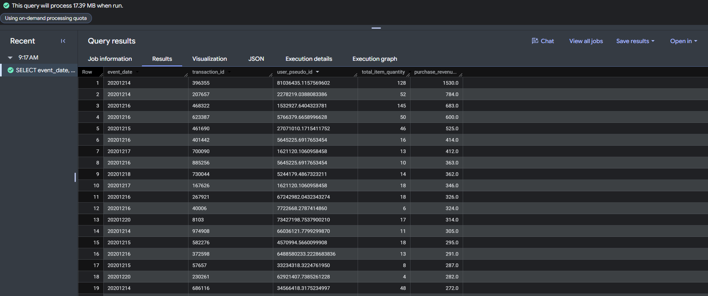
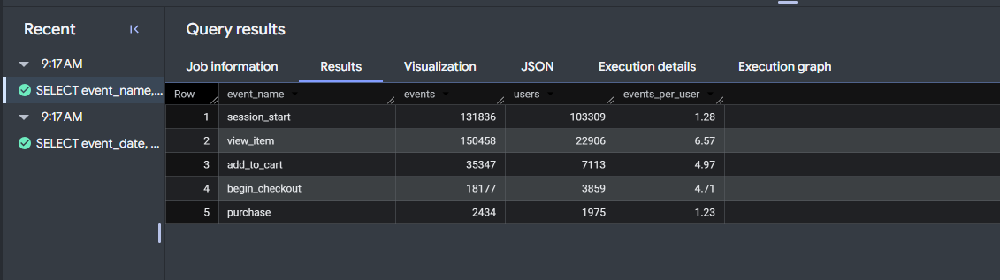
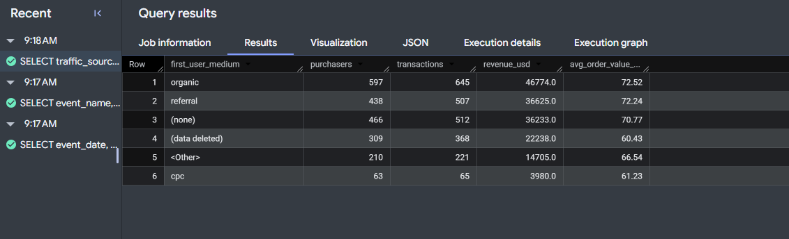
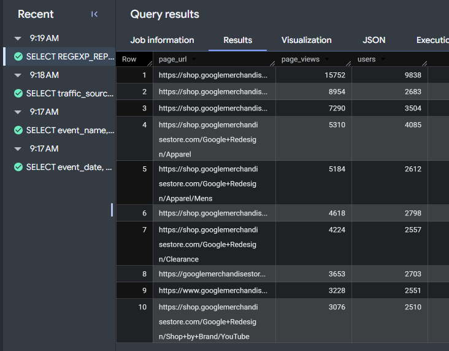
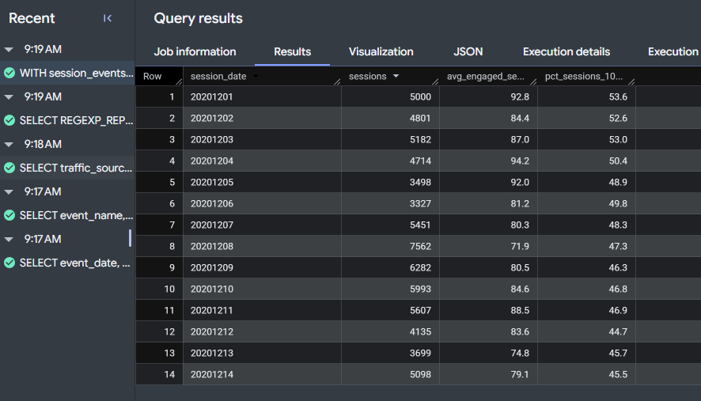
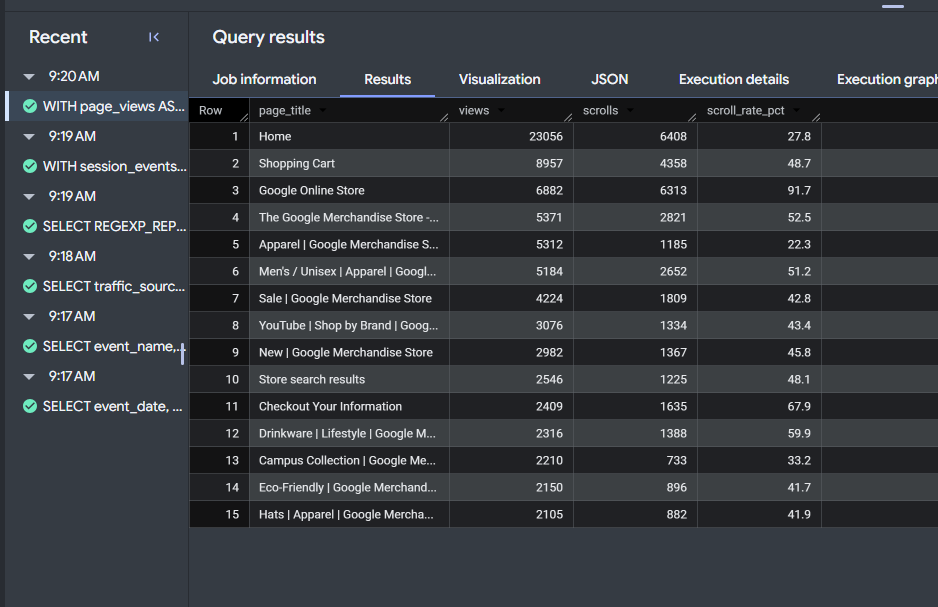
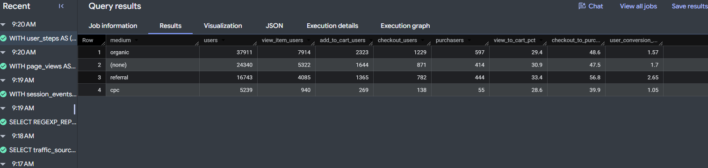
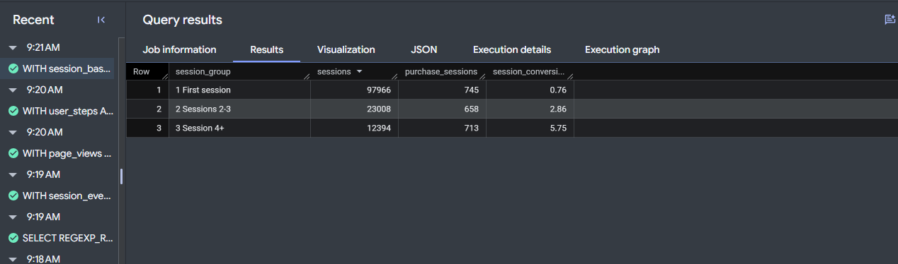

# Overview {.unnumbered}

This SQL pack contains eight GoogleSQL queries on the GA4 BigQuery export. Together they cover filtering, grouping, `UNNEST(event_params)`, CTEs, and joins, and each one is written so a teammate can reuse it for our CEP mart. All queries are saved in [`Julieta-Diaz-ga4-sql-pack.sql`](Julieta-Diaz-ga4-sql-pack.sql).

::: {.callout-note}
## Data and context

**Dataset:** `bigquery-public-data.ga4_obfuscated_sample_ecommerce.events_*`, the GA4 export for the Google Merchandise Store (November 1, 2020 to January 31, 2021). Each row is one **event**; parameters such as `page_location` and `ga_session_id` are stored as key/value pairs in the `event_params` array.

**Why this data:** our team does not yet have access to the CPP Farm Store's GA4 export, so I use the public sample, which has the same schema. The queries are framed around my analytics objective, **AO3: evaluate whether Google Shopping Ads would improve traffic-to-purchase conversion**, and will run on the Farm Store export by changing the table name and dates.
:::

## Skill Coverage

| Query | A. Filtering | B. Grouping | C. UNNEST | D. CTE | E. Join / combine |
|-------------------------|:----:|:----:|:----:|:----:|:----:|
| Q1. Purchase transactions in one week | ✓ | | | | |
| Q2. Funnel events vs. users | ✓ | ✓ | | | |
| Q3. Revenue and AOV by medium | ✓ | ✓ | | | |
| Q4. Top pages (`page_location`, string) | ✓ | ✓ | ✓ | | |
| Q5. Daily sessions (`ga_session_id`, int) | ✓ | ✓ | ✓ | ✓ | |
| Q6. Scroll rate by page | ✓ | ✓ | ✓ | ✓ | ✓ (LEFT JOIN) |
| Q7. User funnel by medium | ✓ | ✓ | | ✓ | ✓ (multi-CTE funnel) |
| Q8. Conversion by session number | ✓ | ✓ | ✓ | ✓ | |

: Required skills covered by each query {#tbl-coverage}

## Conventions Used in Every Query

-   **Scope first:** every query limits `_TABLE_SUFFIX` to a fixed window (one week to one month), so BigQuery scans only those daily tables.
-   **Parameter extraction:** `(SELECT value.<type>_value FROM UNNEST(event_params) WHERE key = '...')` returns exactly one value per event without duplicating rows. The value type matches how GA4 stores the key: `string_value` for `page_location` and `page_title`, `int_value` for `ga_session_id`, `ga_session_number`, and `engagement_time_msec`.
-   **Units are named:** columns say whether they count **events**, **users** (`user_pseudo_id`), or **sessions** (`user_pseudo_id` + `ga_session_id`).
-   **Safe math:** `SAFE_DIVIDE` returns NULL instead of an error when a denominator is zero.

# Q1. Purchase Transactions in One Week

[A]{.skill-tag} Filtering & scoping

```sql
SELECT
  event_date,
  ecommerce.transaction_id,
  user_pseudo_id,
  ecommerce.total_item_quantity,
  ecommerce.purchase_revenue_in_usd
FROM `bigquery-public-data.ga4_obfuscated_sample_ecommerce.events_*`
WHERE _TABLE_SUFFIX BETWEEN '20201214' AND '20201220'   -- one week only
  AND event_name = 'purchase'                            -- purchase events only
ORDER BY ecommerce.purchase_revenue_in_usd DESC
LIMIT 25;
```

-   **This query answers:** which purchases happened during the week of December 14 to 20, 2020, and which were the largest?
-   **It works by:** limiting the scan to seven daily tables with `_TABLE_SUFFIX` and keeping only `purchase` events, then reading the transaction ID, item quantity, and revenue from the `ecommerce` record and sorting by revenue.
-   **You'd use it when:** spot-checking orders (for example, the week before a holiday) or validating that purchase tracking records revenue and transaction IDs before building reports on it.
-   **Caveat:** the sample is obfuscated, so some `transaction_id` values appear as `(not set)` and revenue is not real Merchandise Store revenue. `_TABLE_SUFFIX` filters by table date, which is the event date in the property's time zone, not UTC.

{.output-shot fig-alt="BigQuery results for Q1"}

**What the output shows:** The largest order that week was **$1,530 for 128 items** on December 14, followed by $784 (52 items). Most orders in the top 25 fall between about $270 and $530, and several of the biggest orders contain dozens of items, which suggests bulk or corporate buying before the holidays. Scoping to one week kept the scan to **17.39 MB**.

# Q2. Funnel Events vs. Users

[A + B]{.skill-tag} Filtering + grouping

```sql
SELECT
  event_name,
  COUNT(*)                                   AS events,  -- every event row
  COUNT(DISTINCT user_pseudo_id)             AS users,   -- unique browsers/devices
  ROUND(COUNT(*) / COUNT(DISTINCT user_pseudo_id), 2) AS events_per_user
FROM `bigquery-public-data.ga4_obfuscated_sample_ecommerce.events_*`
WHERE _TABLE_SUFFIX BETWEEN '20201201' AND '20201231'
  AND event_name IN ('session_start', 'view_item', 'add_to_cart',
                     'begin_checkout', 'purchase')
GROUP BY event_name
ORDER BY users DESC;
```

-   **This query answers:** how many **events** and how many **distinct users** reached each funnel step in December 2020?
-   **It works by:** filtering to five funnel events with `IN (...)` and one month of tables, then grouping by `event_name` and calculating `COUNT(*)` (events), `COUNT(DISTINCT user_pseudo_id)` (users), and their ratio.
-   **You'd use it when:** you need to see the drop-off between steps and to show stakeholders why event counts and user counts are different metrics.
-   **Caveat:** `COUNT(*)` counts every firing (a user can add to cart five times), so funnel rates should be built on users or sessions, not raw events. `user_pseudo_id` is a browser/device ID, so one person on two devices counts as two users.

{.output-shot fig-alt="BigQuery results for Q2"}

**What the output shows:** Of **103,309 users** who started a session in December, **22,906** viewed an item, **7,113** added to cart, **3,859** began checkout, and **1,975** purchased, so only about **1.9%** of users bought. The events-per-user column shows why units matter: users viewed **6.57** items each but purchased only **1.23** times, so counting `view_item` events would overstate reach more than fivefold.

# Q3. Revenue and Average Order Value by Medium

[B]{.skill-tag} Grouping & aggregation

```sql
SELECT
  traffic_source.medium                                  AS first_user_medium,
  COUNT(DISTINCT user_pseudo_id)                         AS purchasers,
  COUNT(DISTINCT ecommerce.transaction_id)               AS transactions,
  ROUND(SUM(ecommerce.purchase_revenue_in_usd), 2)       AS revenue_usd,
  ROUND(SAFE_DIVIDE(SUM(ecommerce.purchase_revenue_in_usd),
                    COUNT(DISTINCT ecommerce.transaction_id)), 2) AS avg_order_value_usd
FROM `bigquery-public-data.ga4_obfuscated_sample_ecommerce.events_*`
WHERE _TABLE_SUFFIX BETWEEN '20201201' AND '20201231'
  AND event_name = 'purchase'
GROUP BY first_user_medium
ORDER BY revenue_usd DESC;
```

-   **This query answers:** which acquisition mediums bring the most purchasers, transactions, and revenue, and how large is the average order from each?
-   **It works by:** keeping December purchase events, grouping by `traffic_source.medium`, and using `COUNT(DISTINCT ...)` for purchasers and transactions and `SUM(...)` for revenue. `SAFE_DIVIDE` calculates average order value without failing on a zero.
-   **You'd use it when:** comparing the value of paid (`cpc`) vs. organic traffic, which is the core of my AO3 question for the CPP Farm Store.
-   **Caveat:** `traffic_source` holds the medium that **first acquired the user**, not the source of the session in which they bought, so it is a first-touch view. The obfuscated sample also includes `(data deleted)` and `<Other>` mediums.

{.output-shot fig-alt="BigQuery results for Q3"}

**What the output shows:** **Organic** search drove the most purchasers (597) and revenue (**$46,774**), with the highest average order value (**$72.52**). Paid search (**cpc**) was the smallest channel by far: **63 purchasers, $3,980**, and a lower average order of **$61.23**. For AO3, this is a first sign that paid traffic brings fewer and smaller orders, which a Shopping Ads proposal must overcome.

# Q4. Top Pages (page_location, string)

[C]{.skill-tag} UNNEST event_params

```sql
SELECT
  REGEXP_REPLACE(
    (SELECT value.string_value              -- page_location is a STRING
     FROM UNNEST(event_params)
     WHERE key = 'page_location'),
    r'\?.*$', '')                           -- strip ?utm=... so URLs group together
                                             AS page_url,
  COUNT(*)                                   AS page_views,
  COUNT(DISTINCT user_pseudo_id)             AS users
FROM `bigquery-public-data.ga4_obfuscated_sample_ecommerce.events_*`
WHERE _TABLE_SUFFIX BETWEEN '20201201' AND '20201207'
  AND event_name = 'page_view'
GROUP BY page_url
ORDER BY page_views DESC
LIMIT 10;
```

-   **This query answers:** which ten pages received the most page views and users in the first week of December 2020?
-   **It works by:** opening the `event_params` array with a scalar `UNNEST` subquery, matching `key = 'page_location'`, and reading `value.string_value` because URLs are stored as strings. `REGEXP_REPLACE` removes query strings so the same page with different UTM tags is grouped together.
-   **You'd use it when:** identifying the landing and product pages that matter most for SEO (PO3) and for checking whether paid traffic lands on the right pages.
-   **Caveat:** reading `int_value` here would return all NULLs, because the key's value lives in `string_value`. Stripping query strings also merges internal search URLs, which is fine for a top-pages view but not for search analysis.

{.output-shot fig-alt="BigQuery results for Q4"}

**What the output shows:** The top page received **15,752 page views from 9,838 users**, far ahead of the rest. Category pages lead the remaining list: **Apparel** (5,310 views), **Men's Apparel** (5,184), **Clearance** (4,224), and **Shop by Brand: YouTube** (3,076). These are the pages to prioritize for SEO and as landing pages for any paid campaign.

# Q5. Daily Sessions and Engagement (ga_session_id, int)

[C + D]{.skill-tag} UNNEST + CTE

```sql
WITH session_events AS (
  SELECT
    user_pseudo_id,
    event_date,
    (SELECT value.int_value FROM UNNEST(event_params)
     WHERE key = 'ga_session_id')           AS session_id,      -- INT
    (SELECT value.int_value FROM UNNEST(event_params)
     WHERE key = 'engagement_time_msec')    AS engagement_msec  -- INT
  FROM `bigquery-public-data.ga4_obfuscated_sample_ecommerce.events_*`
  WHERE _TABLE_SUFFIX BETWEEN '20201201' AND '20201214'
),
sessions AS (
  SELECT
    user_pseudo_id,
    session_id,
    MIN(event_date)                          AS session_date,
    SUM(IFNULL(engagement_msec, 0)) / 1000   AS engaged_seconds
  FROM session_events
  WHERE session_id IS NOT NULL
  GROUP BY user_pseudo_id, session_id        -- session = user + session id
)
SELECT
  session_date,
  COUNT(*)                                   AS sessions,
  ROUND(AVG(engaged_seconds), 1)             AS avg_engaged_seconds,
  ROUND(SAFE_DIVIDE(COUNTIF(engaged_seconds >= 10), COUNT(*)) * 100, 1)
                                             AS pct_sessions_10s_plus
FROM sessions
GROUP BY session_date
ORDER BY session_date;
```

-   **This query answers:** how many sessions happened each day, how long were they engaged on average, and what share lasted at least 10 seconds?
-   **It works by:** a first CTE extracts two **integer** parameters, `ga_session_id` and `engagement_time_msec`, from `event_params`. A second CTE rolls events up to one row per **session** (`user_pseudo_id` + `ga_session_id`) and sums engagement time. The final query summarizes sessions by day.
-   **You'd use it when:** you need session-level metrics, since the GA4 export has no session table and sessions must be rebuilt from event parameters.
-   **Caveat:** `ga_session_id` is only unique **together with** `user_pseudo_id`. A session crossing midnight is assigned to its first date. The 10-second share approximates, but is not identical to, GA4's engaged session (which also counts 2+ page views or a key event).

{.output-shot fig-alt="BigQuery results for Q5"}

**What the output shows:** Daily sessions ranged from **3,327** (Sunday, December 6) to **7,562** (Tuesday, December 8), the same weekend dip and early-week peak seen in my Lecture 1 work. Average engaged time per session ran from **72 to 94 seconds**, but the share of sessions engaged for at least 10 seconds **fell steadily from 53.6% to 45.5%** over the two weeks, possibly because holiday traffic brought in more casual browsers.

# Q6. Scroll Rate by Page (JOIN)

[C + E]{.skill-tag} UNNEST + join

```sql
WITH page_views AS (
  SELECT
    (SELECT value.string_value FROM UNNEST(event_params)
     WHERE key = 'page_title')               AS page_title,
    COUNT(*)                                 AS views
  FROM `bigquery-public-data.ga4_obfuscated_sample_ecommerce.events_*`
  WHERE _TABLE_SUFFIX BETWEEN '20201201' AND '20201207'
    AND event_name = 'page_view'
  GROUP BY page_title
),
scrolls AS (
  SELECT
    (SELECT value.string_value FROM UNNEST(event_params)
     WHERE key = 'page_title')               AS page_title,
    COUNT(*)                                 AS scrolls
  FROM `bigquery-public-data.ga4_obfuscated_sample_ecommerce.events_*`
  WHERE _TABLE_SUFFIX BETWEEN '20201201' AND '20201207'
    AND event_name = 'scroll'
  GROUP BY page_title
)
SELECT
  v.page_title,
  v.views,
  IFNULL(s.scrolls, 0)                       AS scrolls,
  ROUND(SAFE_DIVIDE(IFNULL(s.scrolls, 0), v.views) * 100, 1) AS scroll_rate_pct
FROM page_views AS v
LEFT JOIN scrolls AS s                        -- keep pages with no scrolls
  ON v.page_title = s.page_title
WHERE v.views >= 500                          -- ignore low-traffic pages
ORDER BY v.views DESC
LIMIT 15;
```

-   **This query answers:** on high-traffic pages, what percent of page views were followed by a scroll event?
-   **It works by:** two CTEs extract `page_title` (a string parameter) and count `page_view` and `scroll` events separately. A `LEFT JOIN` on `page_title` combines them so pages with no scrolls stay in the result, and `SAFE_DIVIDE` computes the scroll rate. Pages under 500 views are excluded.
-   **You'd use it when:** finding pages where visitors leave before reading, which are candidates for content or layout fixes under the website optimization objective.
-   **Caveat:** the enhanced-measurement `scroll` event fires once per page, at 90% depth, so this is a "deep scroll" rate. Different URLs can share a page title, and very short pages can reach 90% without real scrolling.

{.output-shot fig-alt="BigQuery results for Q6"}

**What the output shows:** The **Home** page had the most views (**23,056**) but only a **27.8%** scroll rate, and **Apparel** was lowest at **22.3%**, so most visitors leave or click away before reaching the bottom. Checkout (**67.9%**) and the **Google Online Store** page (**91.7%**) are scrolled far more, likely because they are short pages or task-focused. The Home title's 23,056 views exceed Q4's top URL because several URLs share the same title.

# Q7. User Funnel by Medium (multiple CTEs)

[D + E]{.skill-tag} Multi-step funnel

```sql
WITH user_steps AS (
  SELECT
    user_pseudo_id,
    ANY_VALUE(traffic_source.medium)                   AS medium,
    MAX(IF(event_name = 'view_item', 1, 0))            AS viewed_item,
    MAX(IF(event_name = 'add_to_cart', 1, 0))          AS added_to_cart,
    MAX(IF(event_name = 'begin_checkout', 1, 0))       AS began_checkout,
    MAX(IF(event_name = 'purchase', 1, 0))             AS purchased
  FROM `bigquery-public-data.ga4_obfuscated_sample_ecommerce.events_*`
  WHERE _TABLE_SUFFIX BETWEEN '20201201' AND '20201231'
  GROUP BY user_pseudo_id                              -- one row per user
),
channel_funnel AS (
  SELECT
    medium,
    COUNT(*)            AS users,
    SUM(viewed_item)    AS view_item_users,
    SUM(added_to_cart)  AS add_to_cart_users,
    SUM(began_checkout) AS checkout_users,
    SUM(purchased)      AS purchasers
  FROM user_steps
  WHERE medium IN ('organic', 'cpc', '(none)', 'referral')
  GROUP BY medium
)
SELECT
  medium,
  users,
  view_item_users,
  add_to_cart_users,
  checkout_users,
  purchasers,
  ROUND(SAFE_DIVIDE(add_to_cart_users, view_item_users) * 100, 1) AS view_to_cart_pct,
  ROUND(SAFE_DIVIDE(purchasers, checkout_users) * 100, 1)        AS checkout_to_purchase_pct,
  ROUND(SAFE_DIVIDE(purchasers, users) * 100, 2)                 AS user_conversion_pct
FROM channel_funnel
ORDER BY users DESC;
```

-   **This query answers:** for each acquisition medium, how many users reached each funnel step, and where does each channel lose shoppers?
-   **It works by:** the first CTE flags, for each user, whether they ever viewed an item, added to cart, began checkout, or purchased in December (`MAX(IF(...))`). The second CTE sums those flags by medium. The final query adds step-to-step and overall conversion rates.
-   **You'd use it when:** answering AO3 directly. Comparing `cpc` with `organic` shows whether paid visitors convert differently and at which step, which is the evidence needed before recommending Google Shopping Ads.
-   **Caveat:** steps are not forced to occur in order or in the same session (a user may purchase without a recorded `view_item`). Medium is first-user medium, as in Q3.

{.output-shot fig-alt="BigQuery results for Q7"}

**What the output shows:** Paid search (**cpc**) has the **lowest user conversion rate: 1.05%**, compared with **1.57%** for organic and **2.65%** for referral. The gap is not at the top of the funnel: cpc users add to cart at nearly the same rate as organic users (**28.6% vs. 29.4%** of item viewers). The loss happens at the end, where only **39.9%** of cpc users who begin checkout complete a purchase, compared with **48.6%** for organic. For AO3, this points to checkout friction for paid visitors as the problem to fix before scaling Shopping Ads. (Q7 shows 55 cpc purchasers versus 63 in Q3 because Q7 assigns each user one medium with `ANY_VALUE`, while Q3 reads the medium on each purchase event; a user's stored medium can differ across days.)

# Q8. Conversion by Session Number

[C + D]{.skill-tag} UNNEST + CTE

```sql
WITH session_base AS (
  SELECT
    user_pseudo_id,
    event_name,
    (SELECT value.int_value FROM UNNEST(event_params)
     WHERE key = 'ga_session_id')            AS session_id,
    (SELECT value.int_value FROM UNNEST(event_params)
     WHERE key = 'ga_session_number')        AS session_number
  FROM `bigquery-public-data.ga4_obfuscated_sample_ecommerce.events_*`
  WHERE _TABLE_SUFFIX BETWEEN '20201201' AND '20201231'
),
sessions AS (
  SELECT
    user_pseudo_id,
    session_id,
    MAX(session_number)                      AS session_number,
    MAX(IF(event_name = 'purchase', 1, 0))   AS has_purchase
  FROM session_base
  WHERE session_id IS NOT NULL
  GROUP BY user_pseudo_id, session_id
)
SELECT
  CASE
    WHEN session_number IS NULL          THEN '4 Unknown'
    WHEN session_number = 1              THEN '1 First session'
    WHEN session_number BETWEEN 2 AND 3  THEN '2 Sessions 2-3'
    ELSE                                      '3 Session 4+'
  END                                        AS session_group,
  COUNT(*)                                   AS sessions,
  SUM(has_purchase)                          AS purchase_sessions,
  ROUND(SAFE_DIVIDE(SUM(has_purchase), COUNT(*)) * 100, 2) AS session_conversion_pct
FROM sessions
GROUP BY session_group
ORDER BY session_group;
```

-   **This query answers:** do first sessions or repeat sessions convert better?
-   **It works by:** extracting the integer parameters `ga_session_id` and `ga_session_number` in a base CTE, collapsing to one row per session with a purchase flag, and grouping sessions into first, 2nd to 3rd, and 4th-plus visits to compare the share of sessions that include a purchase.
-   **You'd use it when:** deciding whether to invest in **bringing visitors back** (email, remarketing) versus acquiring new ones. In my M08 regression, returning visitors were far more likely to buy.
-   **Caveat:** `ga_session_number` counts sessions per device and resets if cookies are cleared, so some "first" sessions are really returning people. Sessions without a session number are grouped as Unknown.

{.output-shot fig-alt="BigQuery results for Q8"}

**What the output shows:** Conversion rises sharply with each return visit: **0.76%** of first sessions include a purchase, compared with **2.86%** for sessions 2 to 3 and **5.75%** for the 4th session onward, about **7.6 times** the first-session rate. Even though first sessions are 73% of all sessions, repeat sessions produce most of the purchase sessions (1,371 of 2,116). This supports pairing any acquisition spend with remarketing that brings visitors back.

# GA4 Quirks to Remember {.unnumbered}

| Quirk | Why it matters | How these queries handle it |
|------------------------|--------------------------|--------------------------|
| No session table | Sessions must be rebuilt | `user_pseudo_id` + `ga_session_id` (Q5, Q8) |
| Parameters live in an array | Can't select them directly | Scalar `UNNEST` subquery with a key match (Q4 to Q6, Q8) |
| Each key has one value type | Wrong type returns NULL | `string_value` for text, `int_value` for IDs and counts |
| `traffic_source` is first-touch | Not the session's source | Labeled "first-user medium" (Q3, Q7) |
| Events vs. users vs. sessions | Different denominators | Columns are named by unit (Q2) |
| Obfuscated sample | `(data deleted)`, `<Other>`, `(not set)` values | Called out in caveats; results are illustrative |

: GA4 export quirks {#tbl-quirks}

# Appendix {.unnumbered}

## Project Links {.unnumbered}

-   [GitHub Repository](https://github.com/jukedz/ibm6500-assignments/tree/main/GA4-4-SQL-Pack)
-   [GitHub Pages Website](https://jukedz.github.io/ibm6500-assignments/GA4-4-SQL-Pack/ga4-sql-pack.html)
-   [SQL file](Julieta-Diaz-ga4-sql-pack.sql)
-   [GA4 BigQuery Export schema](https://support.google.com/analytics/answer/7029846)
