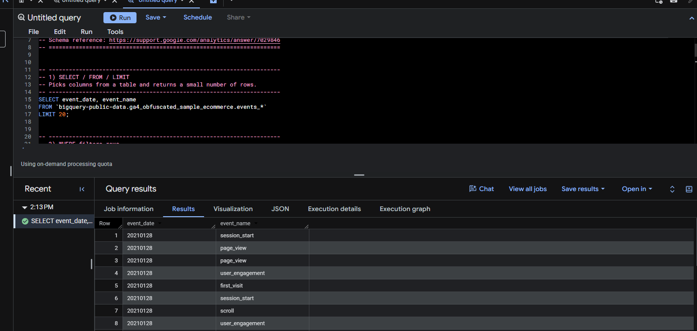
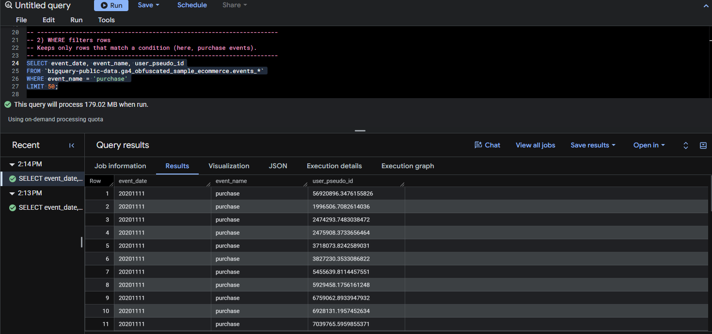
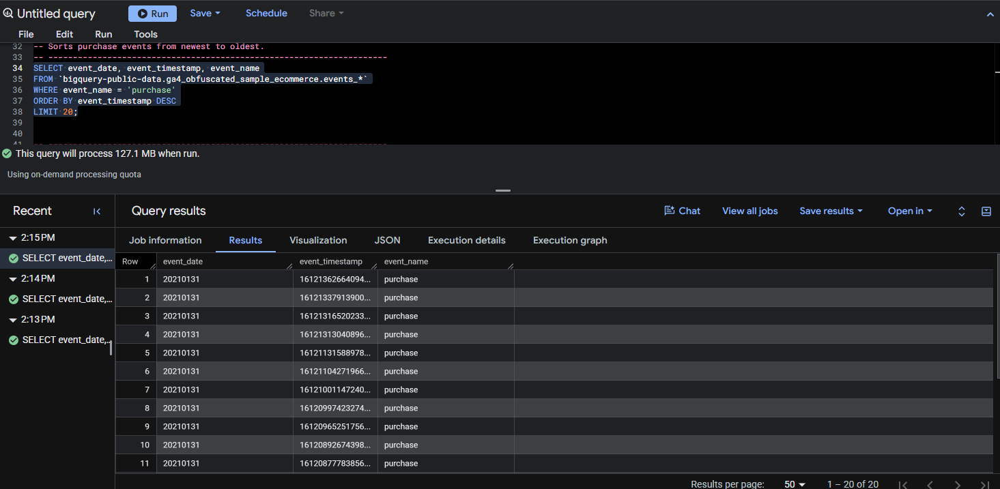
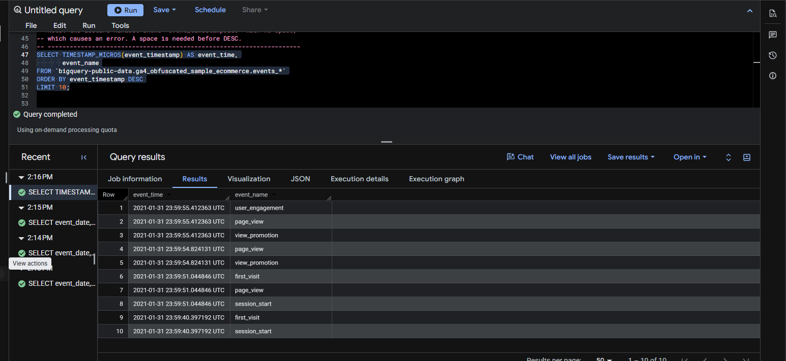
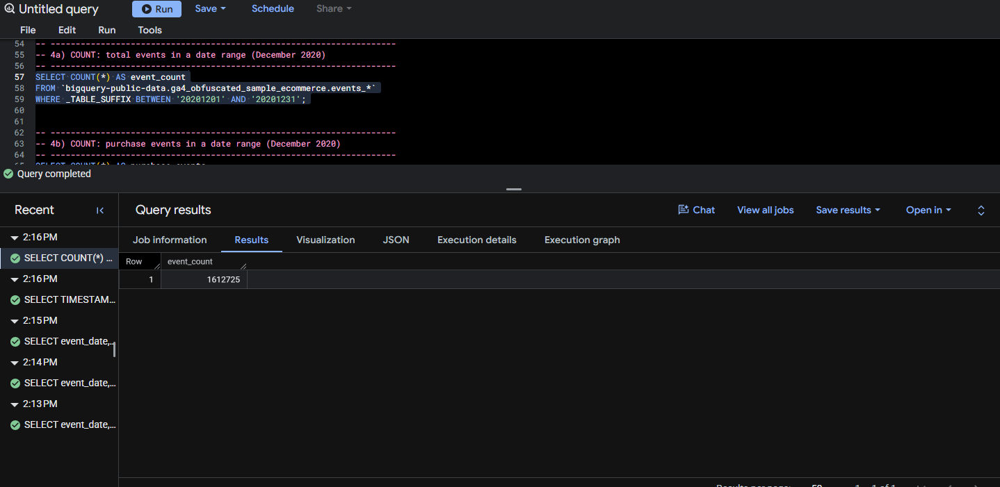
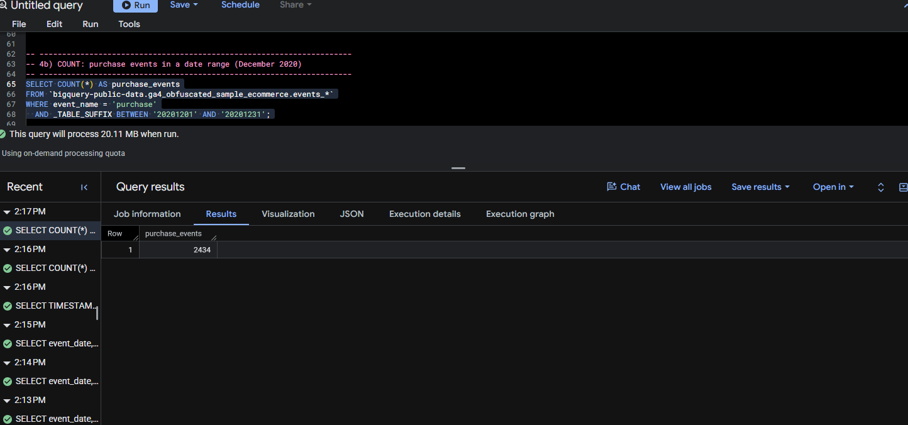
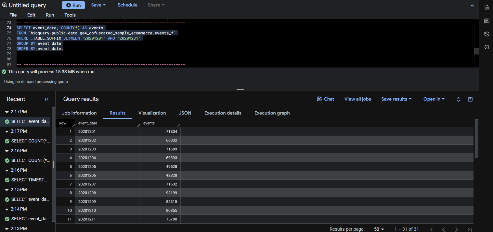
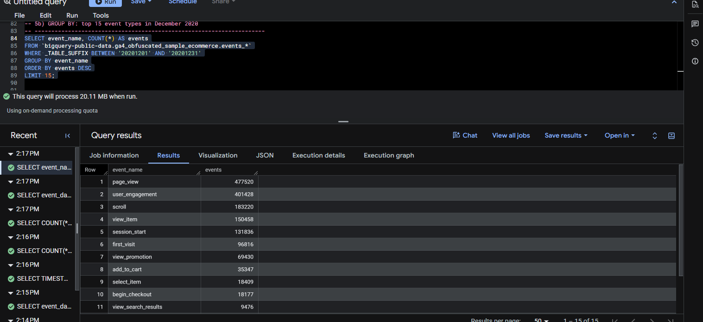
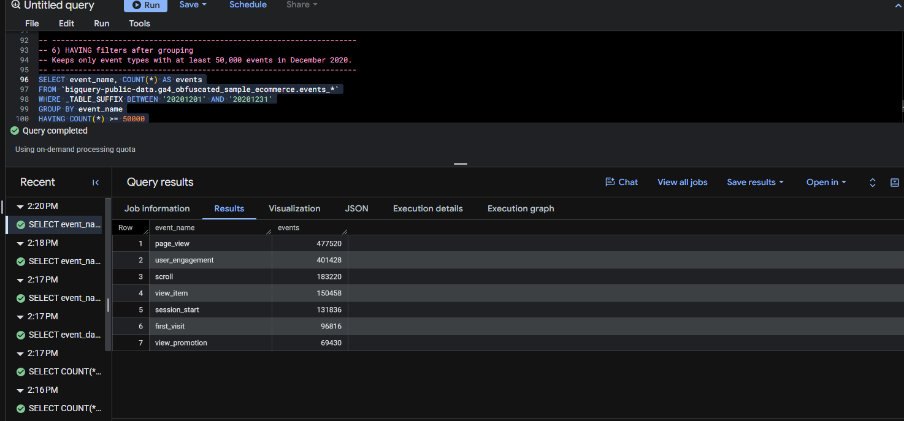
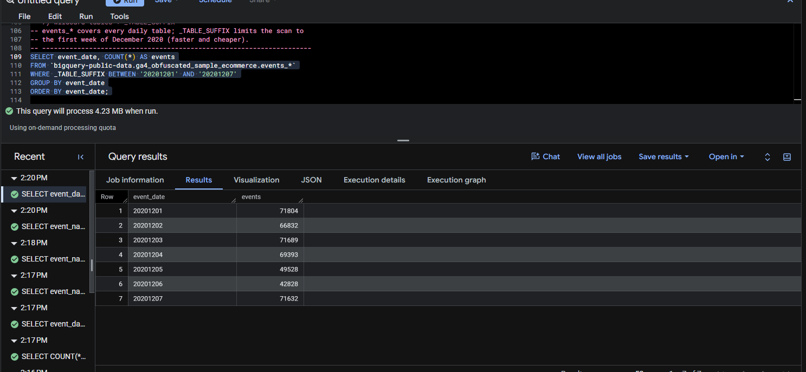

# Overview {.unnumbered}

This notebook documents the queries from **Lecture 1: BigQuery SQL Basics**. Each query was typed into the BigQuery console, run without errors, and saved in [`Julieta-Diaz-lecture1-ga4.sql`](https://github.com/jukedz/ibm6500-assignments/blob/main/IC-CP-W04-BigQuery-SQL-Lecture1/Julieta-Diaz-lecture1-ga4.sql).

::: {.callout-note}
## About the data

All queries use `bigquery-public-data.ga4_obfuscated_sample_ecommerce`, a Google Analytics 4 export for the **Google Merchandise Store**. GA4 writes **one table per day** (for example, `events_20201201`), and each row is one **event**, such as a page view, an add to cart, or a purchase. The [BigQuery Export schema](https://support.google.com/analytics/answer/7029846) describes every field.
:::

| Clause | What it does |
|------------------|------------------------------------------------------|
| `SELECT` | Chooses which columns to return |
| `FROM` | Names the table to read from |
| `WHERE` | Filters rows **before** grouping |
| `GROUP BY` | Sets the grain: what one result row represents |
| `HAVING` | Filters groups **after** aggregating |
| `ORDER BY` | Sorts the results |
| `LIMIT` | Caps how many rows are returned |

: SQL clauses covered in Lecture 1 {#tbl-clauses}

# Selecting and Filtering Rows

## SELECT / FROM / LIMIT

```sql
SELECT event_date, event_name
FROM `bigquery-public-data.ga4_obfuscated_sample_ecommerce.events_*`
LIMIT 20;
```

**What it does:** returns two columns, the date of each event and the event's name, from every daily GA4 table, but only the first 20 rows. `LIMIT` is a quick way to preview a table.

{.output-shot fig-alt="BigQuery results for the SELECT / FROM / LIMIT query"}

**What the output shows:** 20 rows of raw events. In my run, every row happened to come from `20210128`, even though the data covers November 1, 2020 to January 31, 2021. Without `ORDER BY`, BigQuery returns whichever rows it reads first, so `LIMIT` alone is a preview, not a sample of the whole range. Dates are stored as text in `YYYYMMDD` form.

## WHERE Filters Rows

```sql
SELECT event_date, event_name, user_pseudo_id
FROM `bigquery-public-data.ga4_obfuscated_sample_ecommerce.events_*`
WHERE event_name = 'purchase'
LIMIT 50;
```

**What it does:** keeps only rows where the event is a **purchase**, and adds `user_pseudo_id`, the anonymous ID GA4 assigns to each browser or device.

{.output-shot fig-alt="BigQuery results for the WHERE filter on purchases query"}

**What the output shows:** 50 rows where every `event_name` is `purchase`, starting with dates like `20201111`, plus the anonymous `user_pseudo_id` behind each one. The query processed **179.02 MB** because it had to scan every daily table to find the purchases; `LIMIT` does not reduce the bytes scanned.

# Sorting Results

## ORDER BY Sorts Results

```sql
SELECT event_date, event_timestamp, event_name
FROM `bigquery-public-data.ga4_obfuscated_sample_ecommerce.events_*`
WHERE event_name = 'purchase'
ORDER BY event_timestamp DESC
LIMIT 20;
```

**What it does:** returns the 20 **most recent** purchases. `DESC` sorts from largest to smallest timestamp, so the newest come first.

{.output-shot fig-alt="BigQuery results for the ORDER BY newest purchases query"}

**What the output shows:** the newest purchases are all dated `20210131`, the last day in the dataset, which confirms the sort worked. The `event_timestamp` values are 16 digit numbers because GA4 stores time in **microseconds** since January 1, 1970. This query processed **127.1 MB**.

## Readable Timestamps

```sql
SELECT TIMESTAMP_MICROS(event_timestamp) AS event_time,
       event_name
FROM `bigquery-public-data.ga4_obfuscated_sample_ecommerce.events_*`
ORDER BY event_timestamp DESC
LIMIT 10;
```

**What it does:** converts the microsecond timestamp into a readable date and time with `TIMESTAMP_MICROS()`, renames it `event_time` with `AS`, and returns the 10 newest events of any type.

{.output-shot fig-alt="BigQuery results for the readable timestamps query"}

**What the output shows:** the latest event in the dataset was at **2021-01-31 23:59:55 UTC**. Several events share the exact same timestamp (for example `user_engagement`, `page_view`, and `view_promotion`), because one page load can fire multiple events at once. Readable times are much easier to interpret than raw microseconds.

::: {.callout-warning}
## A typo I fixed

The lecture handout shows `ORDER BY event_timestampDESC` with no space, which BigQuery reads as one unknown column name and returns an error. Adding a space (`event_timestamp DESC`) fixes it.
:::

# Summarizing Data

## COUNT: Total Events in December 2020

```sql
SELECT COUNT(*) AS event_count
FROM `bigquery-public-data.ga4_obfuscated_sample_ecommerce.events_*`
WHERE _TABLE_SUFFIX BETWEEN '20201201' AND '20201231';
```

**What it does:** counts every event row in the December 2020 daily tables. `_TABLE_SUFFIX` is the date part of each table name, so the filter scans only those 31 tables.

{.output-shot fig-alt="BigQuery results for the total events in December 2020 query"}

**What the output shows:** one row: **1,612,725 events** in December 2020.

## COUNT: Purchases in December 2020

```sql
SELECT COUNT(*) AS purchase_events
FROM `bigquery-public-data.ga4_obfuscated_sample_ecommerce.events_*`
WHERE event_name = 'purchase'
  AND _TABLE_SUFFIX BETWEEN '20201201' AND '20201231';
```

**What it does:** combines two conditions with `AND` to count only purchase events in December 2020.

{.output-shot fig-alt="BigQuery results for the purchases in December 2020 query"}

**What the output shows:** **2,434 purchases** in December 2020. Compared with 1,612,725 total events, purchases are only about **0.15%** of all activity, roughly 1 purchase for every 660 events. This query processed **20.11 MB** because `_TABLE_SUFFIX` limited the scan to December.

::: {.callout-note}
## Other summary functions

`COUNT` is one of several aggregate functions. `SUM`, `AVG`, `MIN`, and `MAX` work the same way on numeric columns, for example `SUM(ecommerce.purchase_revenue)` for total revenue.
:::

# Grouping Results

## GROUP BY: Events by Day

```sql
SELECT event_date, COUNT(*) AS events
FROM `bigquery-public-data.ga4_obfuscated_sample_ecommerce.events_*`
WHERE _TABLE_SUFFIX BETWEEN '20201201' AND '20201231'
GROUP BY event_date
ORDER BY event_date;
```

**What it does:** sets the **grain** to one row per day. `COUNT(*)` then counts events within each day, and `ORDER BY` lists the days in date order.

{.output-shot fig-alt="BigQuery results for the events by day query"}

**What the output shows:** 31 rows, one per day (**15.38 MB** processed). There is a clear weekly pattern: traffic dips on the weekend (Saturday, Dec 5: 49,528; Sunday, Dec 6: 42,828) and peaks on **Tuesday, Dec 8 at 92,199** events. This is the kind of table that becomes a daily traffic trend chart.

## GROUP BY: Top Event Types

```sql
SELECT event_name, COUNT(*) AS events
FROM `bigquery-public-data.ga4_obfuscated_sample_ecommerce.events_*`
WHERE _TABLE_SUFFIX BETWEEN '20201201' AND '20201231'
GROUP BY event_name
ORDER BY events DESC
LIMIT 15;
```

**What it does:** changes the grain to one row per **event type** and ranks them from most to least common, keeping the top 15.

{.output-shot fig-alt="BigQuery results for the top event types query"}

**What the output shows:** browsing events dominate: `page_view` (477,520), `user_engagement` (401,428), and `scroll` (183,220) lead the list. Shopping steps shrink at each stage: `view_item` (150,458), `add_to_cart` (35,347), and `begin_checkout` (18,177), down to 2,434 purchases from the previous query. That narrowing is the shape of the **conversion funnel**.

# Filtering After Grouping

## HAVING: Event Types With at Least 50,000 Events

```sql
SELECT event_name, COUNT(*) AS events
FROM `bigquery-public-data.ga4_obfuscated_sample_ecommerce.events_*`
WHERE _TABLE_SUFFIX BETWEEN '20201201' AND '20201231'
GROUP BY event_name
HAVING COUNT(*) >= 50000
ORDER BY events DESC;
```

**What it does:** groups events by type, then uses `HAVING` to keep only the types with 50,000 or more events. `WHERE` cannot do this because the count does not exist until after grouping.

{.output-shot fig-alt="BigQuery results for the HAVING filter query"}

**What the output shows:** only **7 of the 15** event types pass the 50,000 cutoff, from `page_view` (477,520) down to `view_promotion` (69,430). Every shopping step after viewing an item, starting with `add_to_cart` (35,347), drops out.

::: {.callout-important}
## WHERE vs. HAVING

`WHERE` filters **rows** before grouping (for example, which dates to include). `HAVING` filters **groups** after aggregating (for example, which event types are large enough to keep).
:::

# Wildcard Tables and \_TABLE_SUFFIX

## Querying One Week of Daily Tables

```sql
SELECT event_date, COUNT(*) AS events
FROM `bigquery-public-data.ga4_obfuscated_sample_ecommerce.events_*`
WHERE _TABLE_SUFFIX BETWEEN '20201201' AND '20201207'
GROUP BY event_date
ORDER BY event_date;
```

**What it does:** the `*` in `events_*` matches every daily table, and `_TABLE_SUFFIX` narrows the scan to December 1 to 7, 2020. BigQuery charges by data scanned, so limiting the dates makes the query **faster and cheaper**.

{.output-shot fig-alt="BigQuery results for the first week of December query"}

**What the output shows:** seven rows, Dec 1 to Dec 7, with counts that match the first seven rows of the "Events by Day" query (for example, 71,804 on Dec 1 and the weekend low of 42,828 on Dec 6). Scanning one week processed only **4.23 MB**, compared with 15.38 MB for the full month, which shows how `_TABLE_SUFFIX` keeps queries cheaper.

# Reflection {.unnumbered}

These basic clauses are the building blocks of my CEP analysis (AO3). In my Revealjs deck, I combined `WHERE`, `COUNT(DISTINCT ...)`, `GROUP BY`, and `_TABLE_SUFFIX` to count users at each funnel step by traffic channel and compare paid vs. organic search conversion. Learning to control the **grain** with `GROUP BY` and to limit scans with `_TABLE_SUFFIX` is what made that analysis possible.

# Appendix: Links {.unnumbered}

- [This report on GitHub Pages](https://jukedz.github.io/ibm6500-assignments/IC-CP-W04-BigQuery-SQL-Lecture1/bigquery-sql-lecture1.html)
- [Source folder on GitHub](https://github.com/jukedz/ibm6500-assignments/tree/main/IC-CP-W04-BigQuery-SQL-Lecture1)
- [SQL file (`Julieta-Diaz-lecture1-ga4.sql`)](https://github.com/jukedz/ibm6500-assignments/blob/main/IC-CP-W04-BigQuery-SQL-Lecture1/Julieta-Diaz-lecture1-ga4.sql)
- [GA4 BigQuery Export schema](https://support.google.com/analytics/answer/7029846)
