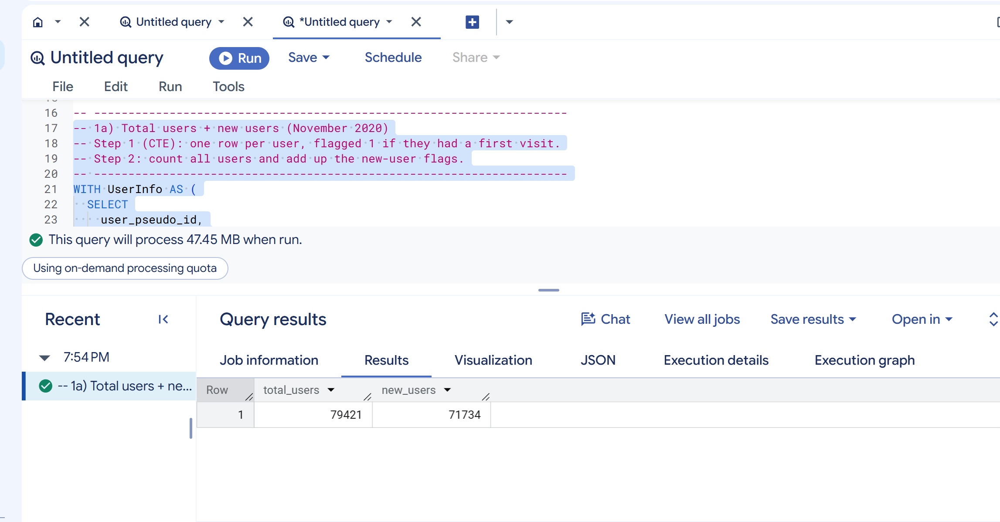
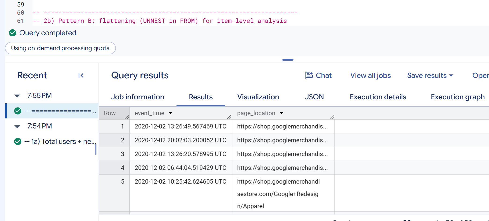
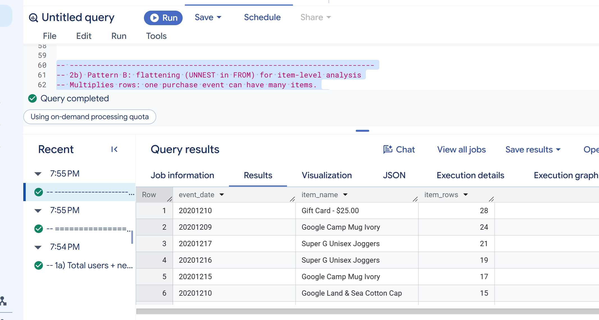
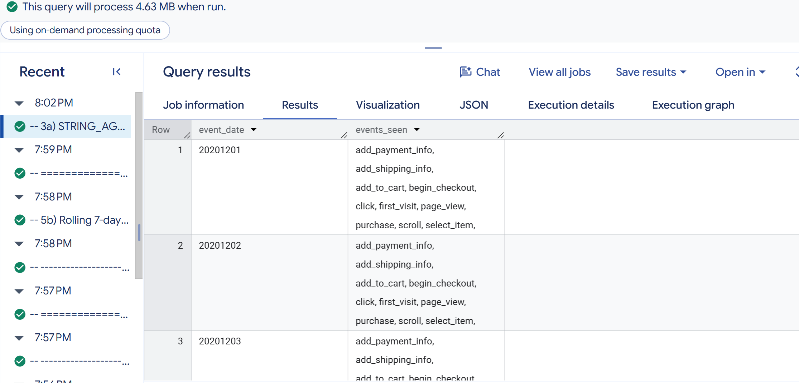
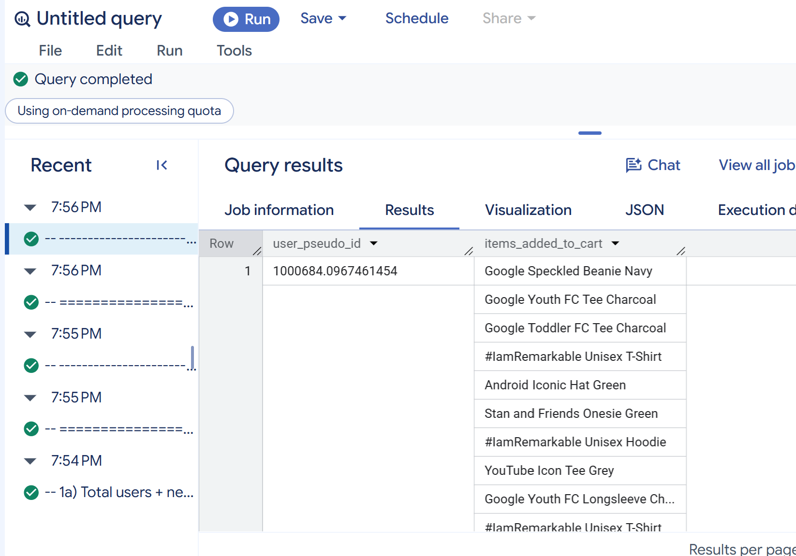
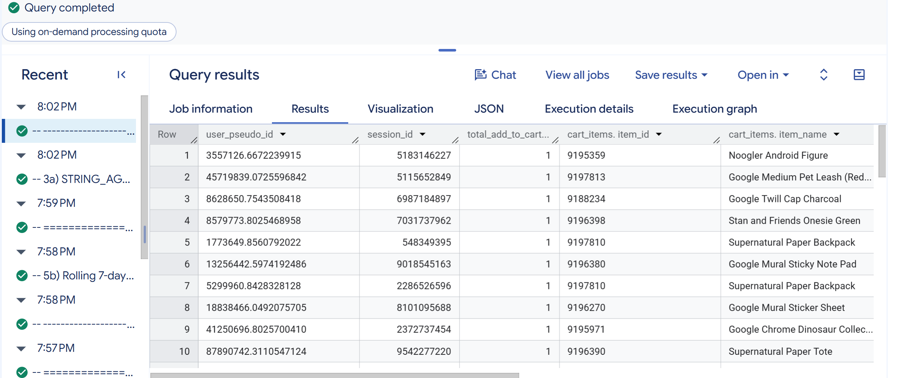
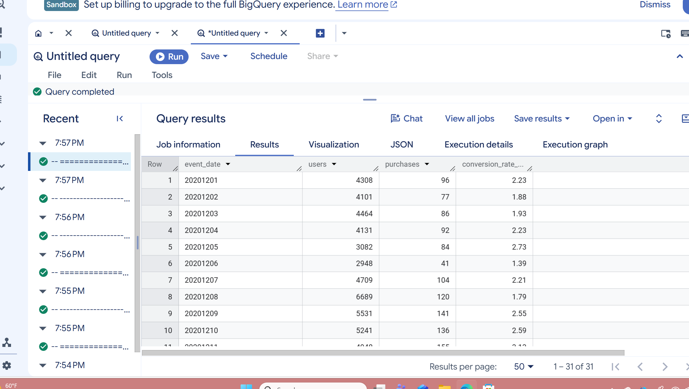
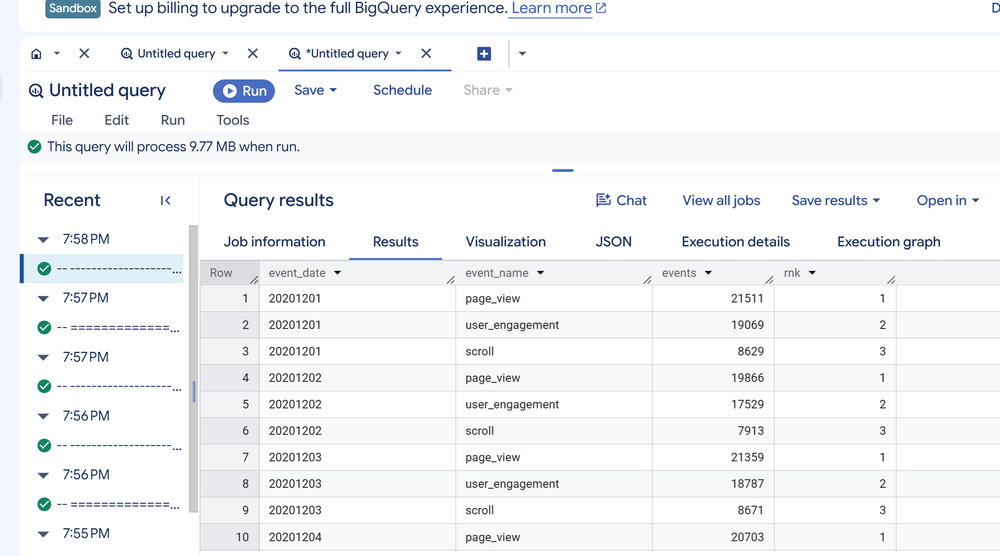
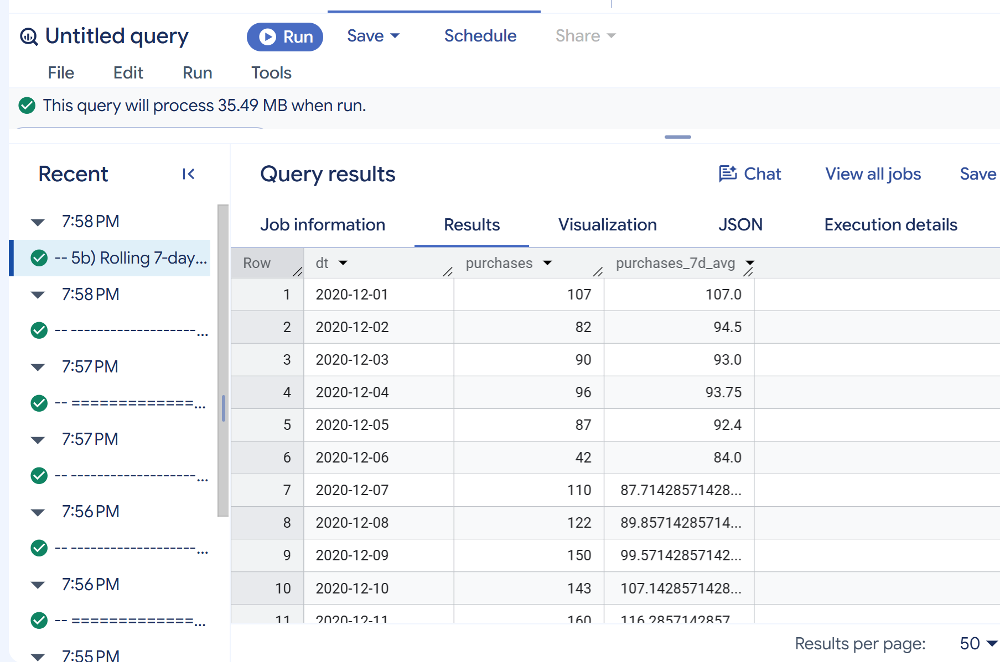
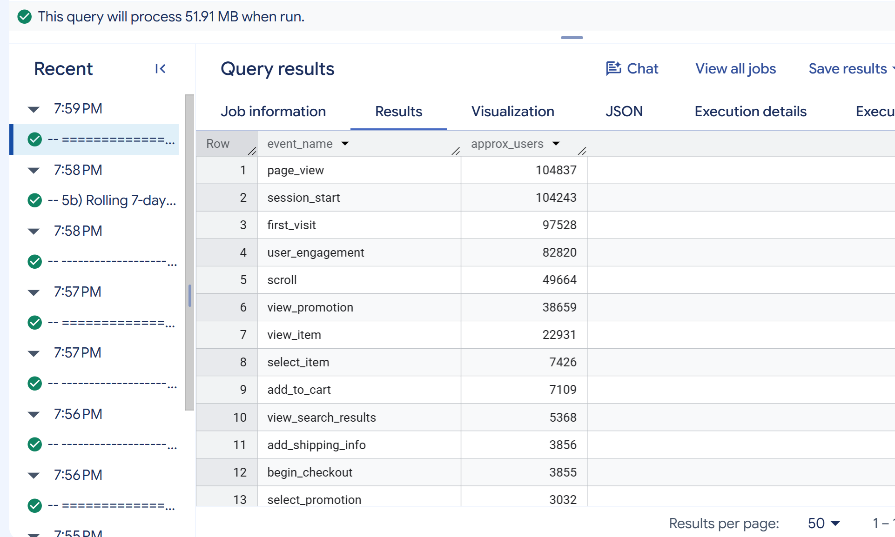

# Overview {.unnumbered}

This notebook documents the queries from **Lecture 2: Intermediate/Advanced BigQuery for GA4**. Each query was typed into the BigQuery console, run without errors, and saved in [`Julieta-Diaz-lecture2-ga4.sql`](https://github.com/jukedz/ibm6500-assignments/blob/main/IC-CP-W05-BigQuery-SQL-Lecture2/Julieta-Diaz-lecture2-ga4.sql). Lecture 1 covered the basic clauses; Lecture 2 builds on them with tools designed for GA4's nested data structure.

::: callout-note
## About the data

All queries use `bigquery-public-data.ga4_obfuscated_sample_ecommerce`, the Google Analytics 4 export for the **Google Merchandise Store** (November 1, 2020 to January 31, 2021). Each row is one **event**, and some fields hold **arrays**: `event_params` stores key/value details such as `page_location` and `ga_session_id`, and `items` stores the products in e-commerce events. The [BigQuery Export schema](https://support.google.com/analytics/answer/7029846) describes every field.
:::

| Technique | What it does |
|-------------------------|-----------------------------------------------|
| `WITH` (CTE) | Creates a named "mini table" inside a query |
| `UNNEST` | Opens an array so its values can be read or turned into rows |
| `STRING_AGG` / `ARRAY_AGG` | Combines many values into one row per group |
| `JOIN` | Combines two result sets that share a key |
| Window functions + `QUALIFY` | Calculate across rows without collapsing them, then filter the result |
| `APPROX_COUNT_DISTINCT` | Returns a fast, close-enough distinct count |

: Techniques covered in Lecture 2 {#tbl-techniques}

# CTEs to Structure Logic

## Total Users and New Users

```sql
WITH UserInfo AS (
  SELECT
    user_pseudo_id,
    MAX(IF(event_name IN ('first_visit', 'first_open'), 1, 0)) AS is_new_user
  FROM `bigquery-public-data.ga4_obfuscated_sample_ecommerce.events_*`
  WHERE _TABLE_SUFFIX BETWEEN '20201101' AND '20201130'
  GROUP BY user_pseudo_id
)
SELECT
  COUNT(*) AS total_users,
  SUM(is_new_user) AS new_users
FROM UserInfo;
```

**What it does:** the CTE `UserInfo` builds one row per user for November 2020. `IF()` marks each event as 1 if it is a first visit (`first_visit` on the web, `first_open` in an app), and `MAX()` keeps a 1 if the user had *any* first-visit event. The main query then counts all users and adds up the flags to get new users.

{.output-shot fig-alt="BigQuery results for the total users and new users query"}

**What the output shows:** one row: **79,421 total users** in November 2020, of whom **71,734 were new**. About **90%** of November's visitors were first-time users, which shows the Merchandise Store relies heavily on attracting new shoppers rather than repeat visits. The query processed 47.45 MB.

# Arrays and UNNEST

## Pattern A: Extracting One Parameter

```sql
SELECT
  TIMESTAMP_MICROS(event_timestamp) AS event_time,
  (
    SELECT value.string_value
    FROM UNNEST(event_params)
    WHERE key = 'page_location'
    LIMIT 1
  ) AS page_location
FROM `bigquery-public-data.ga4_obfuscated_sample_ecommerce.events_*`
WHERE event_name = 'page_view'
  AND _TABLE_SUFFIX BETWEEN '20201201' AND '20201202'
LIMIT 50;
```

**What it does:** for each page view on December 1 and 2, 2020, a **scalar subquery** opens the `event_params` array with `UNNEST`, finds the `page_location` key, and returns its text value. Because the subquery returns only one value, each event stays one row.

{.output-shot fig-alt="BigQuery results for the page_location extraction query"}

**What the output shows:** 50 page views, each with a readable UTC time and the full URL from `shop.googlemerchandisestore.com` (for example, the `Google+Redesign/Apparel` category page). The rows are not in time order because there is no `ORDER BY`. Without `UNNEST`, this URL would be hidden inside the `event_params` array.

## Pattern B: Flattening Items

```sql
SELECT
  event_date,
  item.item_name,
  COUNT(*) AS item_rows
FROM `bigquery-public-data.ga4_obfuscated_sample_ecommerce.events_*` e,
  UNNEST(e.items) AS item
WHERE e.event_name = 'purchase'
  AND _TABLE_SUFFIX BETWEEN '20201201' AND '20201231'
GROUP BY event_date, item.item_name
ORDER BY item_rows DESC
LIMIT 20;
```

**What it does:** placing `UNNEST(e.items)` in the `FROM` clause **flattens** the array, creating one row for every item in every purchase. The query then counts how often each product appeared in purchases on each day of December 2020 and keeps the top 20.

{.output-shot fig-alt="BigQuery results for the flattened purchase items query"}

**What the output shows:** the top product-day combination was the **Gift Card - $25.00 on December 10** with 28 item rows, followed by the **Google Camp Mug Ivory** (24 on December 9 and 17 on December 15) and **Super G Unisex Joggers** (21 on December 17 and 19 on December 16). Gift cards, mugs, and apparel leading in mid-December fits holiday gift shopping.

::: callout-important
## UNNEST changes the grain

After flattening, each row is **one item within one event**, not one event. A purchase with three products becomes three rows, so counting rows here counts items, not purchases.
:::

# STRING_AGG and ARRAY_AGG

## STRING_AGG: Event Types Seen Each Day

```sql
SELECT
  event_date,
  STRING_AGG(DISTINCT event_name, ', ' ORDER BY event_name) AS events_seen
FROM `bigquery-public-data.ga4_obfuscated_sample_ecommerce.events_*`
WHERE _TABLE_SUFFIX BETWEEN '20201201' AND '20201203'
GROUP BY event_date
ORDER BY event_date;
```

**What it does:** groups events by day and uses `STRING_AGG` to combine each day's **distinct** event names into one comma-separated, alphabetized text string.

{.output-shot fig-alt="BigQuery results for the STRING_AGG query"}

**What the output shows:** three rows, one for each of December 1 to 3. Each row holds one alphabetized list of every event type recorded that day, starting with `add_payment_info, add_shipping_info, add_to_cart, begin_checkout, click, first_visit, page_view, purchase, scroll, select_item` and continuing. All three days show the same set of events, which confirms the full shopping funnel was tracked every day. The query processed only 4.63 MB because `_TABLE_SUFFIX` limited it to three days.

::: callout-warning
## A typo I fixed

The lecture handout ends this query with `RDER BY event_date`, missing the "O." BigQuery returns a syntax error, so I corrected it to `ORDER BY`.
:::

## ARRAY_AGG Use Case 1: Items Added to Cart per User

```sql
SELECT
  user_pseudo_id,
  ARRAY_AGG(item_name) AS items_added_to_cart
FROM `bigquery-public-data.ga4_obfuscated_sample_ecommerce.events_*`,
  UNNEST(items) AS item
WHERE event_name = 'add_to_cart'
  AND _TABLE_SUFFIX BETWEEN '20201201' AND '20201231'
GROUP BY user_pseudo_id
ORDER BY user_pseudo_id
LIMIT 10;
```

**What it does:** flattens the items in every add-to-cart event, then uses `ARRAY_AGG` to collect all the product names each user added into a single **array**. Although the lecture comment says "per session," the query groups by `user_pseudo_id`, so each list covers a **user's** whole month.

{.output-shot fig-alt="BigQuery results for the items added to cart per user query"}

**What the output shows:** 10 users, each in a single row with a nested list of products. The first user (`1000684.0967461454`) added more than ten items, including the Google Speckled Beanie Navy, Google Youth FC Tee Charcoal, and Android Iconic Hat Green. Some items, such as the #IamRemarkable Unisex T-Shirt, appear more than once because the user added them in separate add-to-cart events.

## ARRAY_AGG Use Case 2: Session-Level Cart Summary

```sql
WITH add_to_cart AS (
  SELECT
    user_pseudo_id,
    (
      SELECT value.int_value
      FROM UNNEST(event_params)
      WHERE key = 'ga_session_id'
    ) AS session_id,
    TIMESTAMP_MICROS(event_timestamp) AS event_timestamp,
    i.item_id,
    i.item_name,
    i.quantity,
    i.price
  FROM `bigquery-public-data.ga4_obfuscated_sample_ecommerce.events_*`,
    UNNEST(items) AS i
  WHERE event_name = 'add_to_cart'
    AND _TABLE_SUFFIX BETWEEN '20210101' AND '20211231'  -- cost control
)
SELECT
  user_pseudo_id,
  session_id,
  COUNT(*) AS total_add_to_cart_events,                -- added insight
  ARRAY_AGG(
    STRUCT(item_id, item_name, quantity, price, event_timestamp)
    ORDER BY quantity DESC, event_timestamp ASC
    LIMIT 10
  ) AS cart_items
FROM add_to_cart
WHERE session_id IS NOT NULL                            -- filter nulls
GROUP BY user_pseudo_id, session_id;
```

**What it does:** the CTE combines both patterns: a scalar subquery pulls `ga_session_id` from `event_params`, and `UNNEST(items)` flattens the products. The main query groups by **user and session**, counts the add-to-cart rows, and uses `ARRAY_AGG(STRUCT(...))` to store up to 10 items per session, each with its ID, name, quantity, price, and time, sorted by quantity. Sessions without an ID are removed.

{.output-shot fig-alt="BigQuery results for the session cart summary query"}

**What the output shows:** one row per shopping session in January 2021, the latest month in the data (the `20211231` end date simply stops at January 31, 2021). Each row shows the user, the `session_id`, the number of add-to-cart rows, and the nested `cart_items` fields (`item_id`, `item_name`, and so on). In the first ten sessions, each shopper added just **one item**, such as the Noogler Android Figure or the Supernatural Paper Backpack, which appears in two different sessions. Grouping by session instead of by user, as in Use Case 1, shows what was in each individual shopping trip.

# Joins

## Daily Users Joined With Daily Purchases

```sql
WITH daily_users AS (
  SELECT
    event_date,
    COUNT(DISTINCT user_pseudo_id) AS users
  FROM `bigquery-public-data.ga4_obfuscated_sample_ecommerce.events_*`
  WHERE _TABLE_SUFFIX BETWEEN '20201201' AND '20201231'
  GROUP BY event_date
),
daily_purchases AS (
  SELECT
    event_date,
    COUNT(DISTINCT
      (SELECT value.string_value
       FROM UNNEST(event_params)
       WHERE key = 'transaction_id')
    ) AS purchases    -- distinct transactions
  FROM `bigquery-public-data.ga4_obfuscated_sample_ecommerce.events_*`
  WHERE event_name = 'purchase'
    AND _TABLE_SUFFIX BETWEEN '20201201' AND '20201231'
  GROUP BY event_date
)
SELECT
  u.event_date,
  u.users,
  IFNULL(p.purchases, 0) AS purchases,
  ROUND(
    IFNULL(p.purchases, 0) / NULLIF(u.users, 0) * 100, 2
  ) AS conversion_rate_pct
FROM daily_users u
LEFT JOIN daily_purchases p
  ON u.event_date = p.event_date
ORDER BY u.event_date;
```

**What it does:** two CTEs build daily totals, one for unique users and one for distinct transactions (using `transaction_id` from `event_params`). A **LEFT JOIN** on `event_date` keeps every day from `daily_users`, even a day with no purchases. `IFNULL` turns a missing purchase count into 0, and `NULLIF` prevents dividing by zero when calculating the daily **conversion rate**.

{.output-shot fig-alt="BigQuery results for the daily users joined with purchases query"}

**What the output shows:** 31 rows, one per day. On December 1, 4,308 users made 96 purchases, a **2.23%** conversion rate. Traffic peaked on **Tuesday, December 8 (6,689 users)**, but conversion that day was only 1.79%, while the lowest-traffic weekend days split: Saturday, December 5 converted at **2.73%** and Sunday, December 6 at only **1.39%**. More visitors does not automatically mean a higher conversion rate.

::: callout-note
## LEFT JOIN vs. INNER JOIN

An **INNER JOIN** keeps only dates found in *both* tables, so a day with zero purchases would disappear. A **LEFT JOIN** keeps every row from the left table (`daily_users`), which is what a complete daily time series needs.
:::

::: callout-tip
## Transactions vs. purchase events

This query counts **distinct `transaction_id` values** (96 on December 1), while the rolling-average query in the next section counts **purchase events** (107 on December 1). The gap suggests some transactions were recorded more than once, so counting distinct transaction IDs is the safer measure of real orders.
:::

# Window Functions and QUALIFY

## Top 3 Event Types per Day

```sql
WITH daily_event_counts AS (
  SELECT
    event_date,
    event_name,
    COUNT(*) AS events
  FROM `bigquery-public-data.ga4_obfuscated_sample_ecommerce.events_*`
  WHERE _TABLE_SUFFIX BETWEEN '20201201' AND '20201207'
  GROUP BY event_date, event_name
)
SELECT
  event_date,
  event_name,
  events,
  RANK() OVER (PARTITION BY event_date ORDER BY events DESC) AS rnk
FROM daily_event_counts
QUALIFY rnk <= 3
ORDER BY event_date, rnk;
```

**What it does:** the CTE counts events by day and type. `RANK() OVER (PARTITION BY event_date ...)` ranks event types **within each day** from most to least common, without collapsing the rows. `QUALIFY` then filters on the window result to keep only the top 3 per day, something `WHERE` cannot do because the rank is calculated after `WHERE` runs.

{.output-shot fig-alt="BigQuery results for the top 3 event types per day query"}

**What the output shows:** the top 3 event types for each day of December 1 to 7. The ranking is the same every day: **page_view** is first (for example, 21,511 on December 1), **user_engagement** is second (19,069), and **scroll** is third (8,629). The query processed 9.77 MB.

## Rolling 7-Day Average of Daily Purchases

```sql
WITH daily_purchases AS (
  SELECT
    PARSE_DATE('%Y%m%d', event_date) AS dt,
    COUNT(*) AS purchases
  FROM `bigquery-public-data.ga4_obfuscated_sample_ecommerce.events_*`
  WHERE event_name = 'purchase'
    AND _TABLE_SUFFIX BETWEEN '20201201' AND '20201231'
  GROUP BY dt
)
SELECT
  dt,
  purchases,
  AVG(purchases) OVER (
    ORDER BY dt
    ROWS BETWEEN 6 PRECEDING AND CURRENT ROW
  ) AS purchases_7d_avg
FROM daily_purchases
ORDER BY dt;
```

**What it does:** `PARSE_DATE` converts the text date into a real `DATE`, and the CTE counts purchases per day. The window `AVG(...) OVER (ORDER BY dt ROWS BETWEEN 6 PRECEDING AND CURRENT ROW)` averages each day with the 6 days before it, creating a **rolling 7-day average** that smooths daily ups and downs.

{.output-shot fig-alt="BigQuery results for the rolling 7-day purchase average query"}

**What the output shows:** 31 rows of daily purchase events next to the 7-day average. The first row's average equals its own value (107.0) because there are no earlier days, and the first six averages use fewer than seven days. A low Sunday (42 purchases on December 6) pulls the average down to 84.0, then purchases climb (150 on December 9, 160 on December 11) and the average rises to about **116** by December 11, showing the pre-holiday build-up more clearly than the daily numbers. The query processed 35.49 MB.

# Approximate Functions

## Approximate Distinct Users per Event Type

```sql
SELECT
  event_name,
  APPROX_COUNT_DISTINCT(user_pseudo_id) AS approx_users
FROM `bigquery-public-data.ga4_obfuscated_sample_ecommerce.events_*`
WHERE _TABLE_SUFFIX BETWEEN '20201201' AND '20201231'
GROUP BY event_name
ORDER BY approx_users DESC
LIMIT 15;
```

**What it does:** estimates how many unique users triggered each event type in December 2020. `APPROX_COUNT_DISTINCT` uses an estimation algorithm instead of an exact count, which is much faster and cheaper on very large tables, with a small margin of error.

{.output-shot fig-alt="BigQuery results for the approximate users per event type query"}

**What the output shows:** the 15 event types ranked by approximate users in December 2020. **page_view** (104,837) and **session_start** (104,243) reached almost every user, while only **7,109 users added to cart** and **3,855 began checkout**. That drop from about 105,000 viewers to under 4,000 checkout users is the conversion funnel, measured in users instead of events. The query processed 51.91 MB.

# Reflection {.unnumbered}

Lecture 2 showed me how to work with GA4's nested structure, which is exactly what my CEP analysis (AO3) needs. To compare paid and organic search conversion, I have to pull values out of `event_params` with `UNNEST`, build user-level tables with CTEs, and join users to purchases with a `LEFT JOIN` so days or channels with no purchases still appear. Window functions will also help me show trends over time, such as a rolling average of daily conversions, once the Farm Store's GA4 data is available.

# Appendix: Links {.unnumbered}

- [This report on GitHub Pages](https://jukedz.github.io/ibm6500-assignments/IC-CP-W05-BigQuery-SQL-Lecture2/bigquery-sql-lecture2.html)
- [Source folder on GitHub](https://github.com/jukedz/ibm6500-assignments/tree/main/IC-CP-W05-BigQuery-SQL-Lecture2)
- [SQL file (`Julieta-Diaz-lecture2-ga4.sql`)](https://github.com/jukedz/ibm6500-assignments/blob/main/IC-CP-W05-BigQuery-SQL-Lecture2/Julieta-Diaz-lecture2-ga4.sql)
- [GA4 BigQuery Export schema](https://support.google.com/analytics/answer/7029846)
