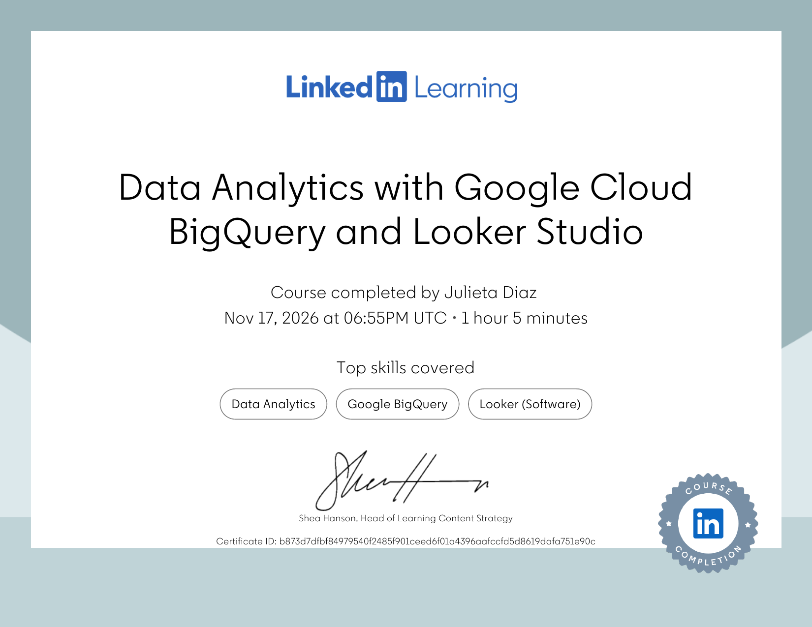

# Course Overview

|  |  |
|-------------------|----------------------------------------------------|
| **Course** | Data Analytics with Google Cloud BigQuery and Looker Studio (LinkedIn Learning) |
| **Length** | About 1 hour 5 minutes |
| **Tools** | **Google BigQuery** (cloud data warehouse queried with SQL) and **Looker Studio** (Google's free dashboard and reporting tool) |
| **Project thread** | Analyzing and visualizing **global temperature changes** with public weather data |
| **Skills** | Data analytics, Google BigQuery, Looker (software) |

: Course at a glance

The course follows one workflow from start to finish: **find data in BigQuery, shape it with SQL, connect the results to Looker Studio, and turn them into charts**. Each chapter adds a new SQL skill and a new chart type, and ends with a challenge that applies both to the temperature data.

```{mermaid}
%%| fig-cap: "The BigQuery to Looker Studio workflow used throughout the course"
flowchart LR
  A[BigQuery public dataset] --> B[SQL query<br/>filter, aggregate, join]
  B --> C[Query results or saved table]
  C --> D[Looker Studio data source]
  D --> E[Charts and dashboards<br/>line, column, geo]
```

# Chapter 1: Visualizing BigQuery Data as Line Charts in Looker Studio

## Introduction to Google Cloud BigQuery and Looker Studio

- **BigQuery** is Google Cloud's serverless data warehouse. It stores very large tables and runs SQL on them quickly without managing any servers.
- **Looker Studio** (formerly Google Data Studio) connects to data sources such as BigQuery and builds interactive reports and dashboards.
- Used together, BigQuery does the heavy data work and Looker Studio presents the results to decision makers.

## Using a Public Dataset in BigQuery

- BigQuery hosts many free **public datasets** under the `bigquery-public-data` project, which can be added to the **Explorer** panel in the SQL Workspace.
- Data is organized in a hierarchy: **project → dataset → table**.
- Clicking a table opens three useful tabs:
  - **Schema:** column names and data types.
  - **Details:** table size, number of rows, and the **table ID**, which can be copied for use in a query.
  - **Preview:** a sample of rows, which is free to view (unlike running a query).

## Running an SQL Query in BigQuery

- Queries are written in the SQL editor and run with **Run**. The validator shows how much data the query will process **before** it runs, which matters because BigQuery charges by data scanned.
- Table IDs must be enclosed in **backticks**, for example `` `project.dataset.table` ``.
- Selecting only the columns needed (instead of `SELECT *`) reduces the data scanned and the cost.

``` sql
-- General pattern
SELECT column_1, column_2
FROM `project.dataset.table`
WHERE condition
LIMIT 100;
```

## Aggregation Functions in BigQuery

Aggregation functions summarize many rows into one value per group:

| Function          | Returns                                          |
|-------------------|--------------------------------------------------|
| `COUNT()`         | Number of rows (or non-NULL values)              |
| `SUM()`           | Total of the values                              |
| `AVG()`           | **Average of the non-NULL values** in each group |
| `MIN()` / `MAX()` | Smallest / largest value                         |

: Common aggregation functions

- `GROUP BY` defines the groups (for example, one row per year).
- Clause order matters: `SELECT ... FROM ... WHERE ... GROUP BY ... ORDER BY ...`. A query such as `SELECT AVG(score), year FROM score_table GROUP BY year ORDER BY score` is valid, while putting `ORDER BY` before `GROUP BY`, or `FROM` at the end, is not.

``` sql
-- Example pattern: average temperature per year
SELECT year, AVG(temp) AS avg_temp
FROM `project.dataset.table`
GROUP BY year
ORDER BY year;
```

## Aggregation Across Multiple Tables in BigQuery

- When data is spread across several tables, such as **one table per year** with a shared prefix, BigQuery can query them together with a **wildcard table** (`table_prefix*`), and the pseudo-column `_TABLE_SUFFIX` identifies or filters which tables are included.
- This makes it possible to calculate one long time series (for example, average temperature across many years) in a single query.

## Creating a Line Chart in Looker Studio

- Query results can be sent to Looker Studio with **Explore data**, or a saved table can be added as a **BigQuery data source** in a new report.
- A chart needs a **dimension** (what to group by, such as year) and a **metric** (what to measure, such as average temperature).
- A **line chart** is the natural choice for a trend over time.

## Challenge and Solution: Visualize Global Temperature Changes

The chapter challenge combined everything: aggregate temperature by year across the yearly tables, then plot the result as a line chart in Looker Studio to show how global average temperature has changed over time.

::: callout-tip
## Key takeaway, Chapter 1

The basic workflow is **query → aggregate → connect → chart**. Getting the data to the right level (one row per year) in SQL makes the Looker Studio chart simple.
:::

# Chapter 2: Dimensions and Column Charts in Looker Studio

## Joining Two Datasets in BigQuery

- A `JOIN` combines rows from two tables that share a key column, for example, joining weather measurements to a stations table to get each station's country.
- In BigQuery, plain `JOIN` means **`INNER JOIN`**: only rows with a match in both tables are kept. `LEFT JOIN`, `RIGHT JOIN`, and `FULL OUTER JOIN` keep unmatched rows from one or both sides.
- Table aliases (for example, `a` and `b`) keep joined queries readable.

``` sql
-- Example pattern
SELECT b.country, a.year, AVG(a.temp) AS avg_temp
FROM `project.dataset.measurements` AS a
JOIN `project.dataset.stations` AS b
  ON a.station_id = b.station_id
GROUP BY b.country, a.year;
```

## Dimensions in Line Charts and Column Charts

- Adding a second **dimension** (such as country) as a **breakdown dimension** splits one line into several lines, one per category.
- **Column charts** compare values across categories, while line charts show change over time.
- Too many categories make a chart unreadable, so filters or a limited number of series keep it focused.

## String Functions in BigQuery

- String functions clean and combine text, for example `CONCAT()`, `UPPER()`, `LOWER()`, `TRIM()`, and `SUBSTR()`.
- The **`||` operator concatenates** strings: `'Big' || 'Query'` returns `BigQuery`. (`&` and `+` do not concatenate strings in BigQuery.)
- The `WHERE` clause **filters** rows, for example keeping only selected countries.

## Updating an Existing BigQuery Data Source in Looker Studio

- When a query or table changes and new fields are added or removed, the data source must be **reconnected** (refresh fields) so Looker Studio sees the **new schema**.
- Simply changing a chart's dimension or metric does not require reconnecting.

## Challenge and Solution: Visualize Temperature Trends in Selected Countries

The challenge combined the chapter's skills: join the temperature data to location information, filter to a few selected countries with `WHERE`, and chart temperature trends with country as a breakdown dimension, so the countries could be compared side by side.

::: callout-tip
## Key takeaway, Chapter 2

Joins add context (such as country) to raw measurements, and dimensions let Looker Studio split one chart into meaningful comparisons.
:::

# Chapter 3: Intermediate SQL Transformation and Geo Charts in Looker Studio

## Creating a Geo Chart in Looker Studio

- A **geo chart** colors countries or regions by a metric. It needs a **geographic dimension** (such as country) with the correct geo field type.
- Looker Studio also offers **Google Maps** chart types: **bubble maps, filled maps, line maps, and heatmaps**.

## Anatomy of a Complex SQL Query

- Complex queries are easier to read and debug when they are built in **steps**.
- The **`WITH` clause** binds a subquery to a name (a **common table expression**, or CTE), which later parts of the query can use like a table.
- A typical structure: one CTE to filter and clean, one to aggregate, and a final `SELECT` that joins or compares them.

``` sql
-- Example pattern
WITH yearly AS (
  SELECT country, year, AVG(temp) AS avg_temp
  FROM `project.dataset.joined_table`
  GROUP BY country, year
),
early AS (SELECT country, AVG(avg_temp) AS t_early FROM yearly WHERE year < 2000 GROUP BY country),
late  AS (SELECT country, AVG(avg_temp) AS t_late  FROM yearly WHERE year >= 2000 GROUP BY country)
SELECT e.country, l.t_late - e.t_early AS temp_change
FROM early AS e
JOIN late AS l USING (country);
```

## Challenge and Solution: Comparing Countries' Temperature Changes in a Geo Chart

The final challenge used a multi-step query to calculate **how much each country's temperature changed** between periods, then displayed the change on a geo chart, so the countries with the largest increases stand out visually.

::: callout-tip
## Key takeaway, Chapter 3

`WITH` clauses turn a complicated question into readable steps, and a geo chart makes country-level differences easy to see at a glance.
:::

# What I Learned and How I Will Use It

1.  **Let SQL do the heavy lifting.** Aggregating and joining in BigQuery before connecting to Looker Studio keeps reports fast and charts simple.
2.  **Watch the cost.** BigQuery charges by data scanned, so selecting only needed columns, using `Preview`, and checking the validator estimate are good habits.
3.  **Choose the chart for the question:** line charts for trends, column charts for comparisons, and geo charts for location.
4.  **Keep data sources in sync.** Reconnect a Looker Studio data source whenever its schema changes.
5.  **Build complex queries in steps** with `WITH` clauses.

These skills connect directly to my other work this semester. In my BigQuery SQL assignments I queried the GA4 sample e-commerce data, and in our CEP project for the CPP Farm Store I am analyzing GA4 conversion data for AO3. Looker Studio is a practical way to share those results with the client as a dashboard (for example, conversion rate by traffic channel over time) that updates directly from BigQuery.

# Certificate of Completion

{#fig-certificate fig-alt="LinkedIn Learning certificate for Data Analytics with Google Cloud BigQuery and Looker Studio, completed by Julieta Diaz on November 17, 2026"}

# Appendix {.unnumbered}

## Project Links {.unnumbered}

- [GitHub Repository](https://github.com/jukedz/ibm6500-assignments/tree/main/M07-BigQuery-Looker-Studio)
- [GitHub Pages Website](https://jukedz.github.io/ibm6500-assignments/M07-BigQuery-Looker-Studio/bigquery-looker-studio-summary.html)